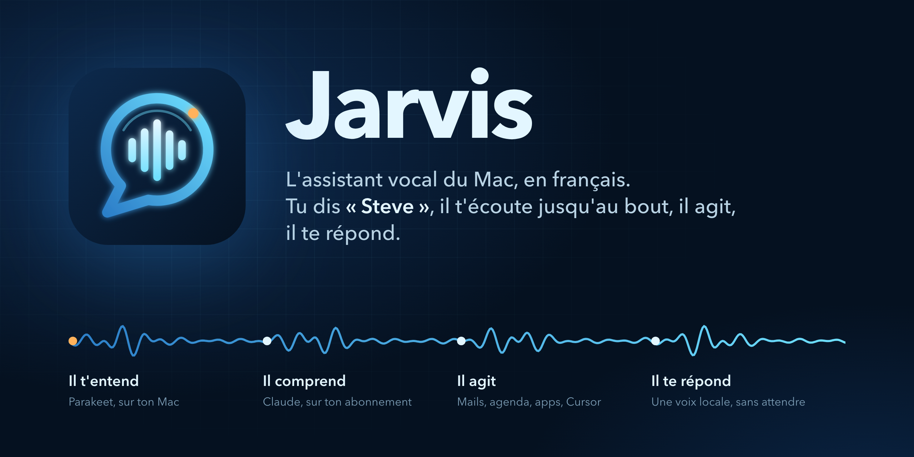

# Jarvis

<a href="README.md">Français</a> · <b>English</b> · <a href="README.zh.md">中文</a> · <a href="README.ka.md">ქართული</a>

An always-listening voice assistant for the Mac. You call it by name (**Steve** by default, or any name you choose),
it understands you, answers out loud, and acts on your Mac: apps, windows, browser, mail, calendar, messages,
background agents running in parallel, and a dashboard. Wake word, speech recognition and the local voice run on the
Apple chip; the thinking is done by Claude, **on your own Claude subscription** (no API key).

It speaks your languages: tell it which ones you speak (English, 中文, ქართული, Español, Deutsch, Русский, 日本語… 25
with a dedicated voice, or all 99 Whisper languages) and, sentence by sentence, it recognises the language you used
and answers in the same one, with a voice of that language.

> The full documentation is in French: [README.md](README.md). The code, its comments and its messages are in
> French too; the assistant itself answers in whatever language you speak to it.

## Install

You need an Apple Silicon Mac, Python 3.12, and a Claude Pro or Max subscription.

    git clone https://github.com/LdwS123/jarvis.git ~/Jervis && cd ~/Jervis
    python3.12 -m venv .venv && .venv/bin/pip install -r requirements.txt
    curl -fsSL https://claude.ai/install.sh | bash   # Claude Code, if you don't have it yet
    claude auth login                                # your own Claude account
    ./reglages.command                               # settings page: name, languages, voice, model
    ./installer.command                              # menu-bar app, starts at login

Its models (voice, speech recognition) download themselves on first launch, into `modeles/`. Your memory,
conversations, logs and voice print stay on your Mac and are never part of the repository.

## The settings page

Open it from the menu-bar icon → **Réglages…**, from the dashboard, or with `./reglages.command` (works before the
first launch). The page itself can be shown in English, 中文 or ქართული.

- **Your Claude account**: shows whether Claude Code is logged in and which plan. *Connect* opens Terminal on
  `claude auth login`; you log in with Claude directly, the page never sees your password or email.
- **Its name** (the wake word too), **your main language**, **the languages you speak to it**, **its local voice**,
  **its Microsoft voice**, **its Claude model** (sonnet, opus, haiku).
- *Save* writes `reglages.json` at the root of the repo (readable by you only, git-ignored). Restart it afterwards:

      pkill -f "Jervis.app/Contents"; pkill -f "python -m jervis"; sleep 2; open -a ~/Jervis/Jervis.app

Every setting can also be set with an environment variable, which always wins over the page:

| Variable | Default | What it does |
|---|---|---|
| `JERVIS_PRENOM` | Steve | its name, and the word that wakes it up |
| `JERVIS_LANGUE` | fr | your main language: announcements, its "let's see…", its everyday voice (`en`, `zh`, `ka`…) |
| `JERVIS_LANGUES` | the main one | the languages you speak to it: `en,zh,ka`, or `toutes` (all) |
| `JERVIS_VOIX_ZH`, `JERVIS_VOIX_KA`… | one per language | its Microsoft voice in that language (`zh-CN-XiaoxiaoNeural`, `ka-GE-EkaNeural`…) |
| `JERVIS_VOIX_NEURONALE` | depends on the main language | its Microsoft voice in your main language; `non` = Mac voices only, nothing sent to Microsoft |
| `JERVIS_MODELE` | sonnet | the Claude model it thinks with |
| `JERVIS_REGLAGES` | `reglages.json` | the settings file; `non` ignores it |

## Languages: what to expect

- Recognising your language happens on the Mac (Whisper listens to the start of your sentence and picks among
  *your* languages only). It adds about 0.2–0.3 s per sentence; with a single language nothing changes.
- European languages go through Parakeet (fast); Chinese, Georgian, Japanese, Arabic… go through Whisper.
- Its local voice (Pocket TTS) speaks French, English, Spanish, German, Italian, Portuguese or Dutch, depending on its model.
  Other languages are spoken with the Microsoft Edge voice of that language (only the text of the reply leaves the
  Mac, never your voice), then a macOS voice as a fallback. There is no macOS voice for Georgian.

## Privacy

Your voice never leaves the Mac: wake word, transcription, language detection and voice print are computed locally.
What you say (as text), and what it reads for you, goes to Claude so it can answer. See the French README for the
full list.
