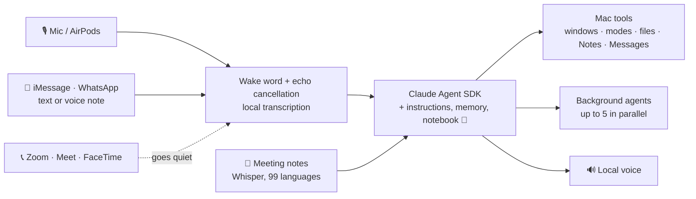

# Jarvis

<a href="README.md">Français</a> · <b>English</b> · <a href="README.zh.md">中文</a> · <a href="README.ka.md">ქართული</a>

  
  
  
  
  
  

**A real "Jarvis" for your Mac.** Say its name (**Steve** by default, or any name you pick), talk normally, and it
**acts**: apps, windows, files, browser, mail, calendar, messages, background agents in parallel. It answers out
loud with a local voice, goes quiet by itself during your calls, takes meeting notes, and learns from your
corrections.

- 🎙️ **Your voice never leaves the Mac**: wake word, speech recognition (Parakeet / Whisper on MLX), language
  detection and its voice (Pocket TTS) all run on the Apple chip.
- 🧠 **The thinking is Claude**, through the Claude Agent SDK, **on your own Claude Pro/Max subscription**: no API
  key, no per-token bill.
- 🌍 **It speaks your languages**: tell it which ones you speak (English, 中文, Español, Deutsch, 日本語, ქართული…)
  and it answers each sentence in the language you used, with a voice of that language.

> The full documentation is in French: [README.md](README.md) (your browser can translate it). The code is in
> French too; the assistant itself answers in whatever language you speak to it.

## What it does

| | What it does | Where it runs |
|---|---|---|
| 🎙️ | Listens ("Steve…"), understands, answers out loud; switches to your headphones or AirPods | on the Mac (wake word, Parakeet/Whisper, local voice) |
| ✋ | **Barge-in**: talk over it and it stops dead to listen, then resumes if you weren't talking to it | on the Mac (echo cancellation) |
| 📞 | **Goes quiet during your calls** (Zoom, Meet, Teams, FaceTime…) and comes back after | on the Mac (CoreAudio) |
| 📝 | **Meeting notes**: transcribes each part in its own language, then a summary and action items in Notes | transcription on the Mac, summary by Claude |
| 🪟 | Windows, **modes** ("work mode"), music, selected text, **folder cleanup** (undoable), **Mac health** | on the Mac |
| 🔎 | "Find the PDF of the March quote": **searches inside** your files | Spotlight, on the Mac |
| 📱 | Text or **send a voice note from your iPhone** (iMessage, or WhatsApp "Message yourself"): it does the task on the Mac and **replies with a voice note** | transcribed and spoken on the Mac |
| 💬 | **Replies to your messages in your style** (iMessage, WhatsApp), or answers for you while you're busy | Claude, with your confirmation rules |
| 📌 | **Learns from you**: correct it once and it keeps the rule | its notebook, `lecons.md` |
| 🤖 | Mail, calendar, Chrome, Mac apps, up to 5 background agents, a live dashboard | Claude (your subscription) |

## Install

You need an Apple Silicon Mac (M1 or later), Python 3.12, and a Claude Pro or Max subscription.

    git clone https://github.com/LdwS123/jarvis.git ~/Jervis && cd ~/Jervis
    python3.12 -m venv .venv && .venv/bin/pip install -r requirements.txt
    ./installer.command                              # setup page, then the menu-bar app (starts at login)

On first run, `installer.command` opens a **setup page** in your browser and waits:

1. **Connect your Claude account**: the button opens Terminal on `claude auth login` (installing Claude Code first
   with the official installer if it's missing). You log in with Claude; the page only sees that it's done (it
   checks again by itself every 3 s), never your password or email.
2. **Choose its settings**: name, languages, voice, model, speed. All optional.
3. **Finish and launch**: enabled once your account is connected; the page closes and the install carries on.

Once connected and saved, the page doesn't come back (`./installer.command --sans-page` skips it). If the app ever
starts without a connected Claude account, its icon turns 🔑, it tells you, opens the settings page on *Connect*,
and starts by itself as soon as you're logged in.

Its models (voice, speech recognition) download themselves on first launch, into `modeles/`. Your memory,
conversations, logs and voice print stay on your Mac and are never part of the repository.

## The settings page

Open it from the menu-bar icon → **Réglages…**, from the dashboard, or with `./reglages.command` (works before the
first launch). The page itself can be shown in English, 中文 or ქართული.

- **Your Claude account**: shows whether Claude Code is logged in and which plan. *Connect* opens Terminal on
  `claude auth login`; you log in with Claude directly, the page never sees your password or email.
- **Its name** (the wake word too), **your main language**, **the languages you speak to it**, **its local voice**,
  **its Microsoft voice**, **its Claude model** (sonnet, opus, haiku), **its response speed** (`low`, the default,
  answers fastest; `medium` or `high` think more before speaking).
- *Save* writes `reglages.json` at the root of the repo (readable by you only, git-ignored). Restart it afterwards:

      pkill -f "Jervis.app/Contents"; pkill -f "python -m jervis"; sleep 2; open -a ~/Jervis/Jervis.app

Every setting can also be set with an environment variable, which always wins over the page:

| Variable | Default | What it does |
|---|---|---|
| `JERVIS_PRENOM` | Steve | its name, and the word that wakes it up |
| `JERVIS_LANGUE` | fr | your main language: announcements, its "let's see…", its everyday voice (`en`, `zh`, `ka`…) |
| `JERVIS_LANGUES` | the main one | the languages you speak to it: `en,zh,ka`, or `toutes` (all) |
| `JERVIS_VOIX_ZH`, `JERVIS_VOIX_KA`… | one per language | its Microsoft voice in that language (`zh-CN-XiaoxiaoNeural`, `ka-GE-EkaNeural`…) |
| `JERVIS_VOIX_NEURONALE` | depends on the main language | its Microsoft voice in your main language; `non` = Mac voices only, nothing sent to Microsoft |
| `JERVIS_MODELE` | sonnet | the Claude model it thinks with |
| `JERVIS_EFFORT` | low | how much it thinks before answering: `low` is fastest out loud, `medium`, `high` think more |
| `JERVIS_COUPURE_S` | 0.5 | seconds of your voice over its own before it stops dead to listen (it resumes if you weren't talking to it) |
| `JERVIS_REGLAGES` | `reglages.json` | the settings file; `non` ignores it |

## Languages: what to expect

- Recognising your language happens on the Mac (Whisper listens to the start of your sentence and picks among
  *your* languages only). It adds about 0.2–0.3 s per sentence; with a single language nothing changes.
- European languages go through Parakeet (fast); Chinese, Georgian, Japanese, Arabic… go through Whisper.
- Its local voice (Pocket TTS) speaks French, English, Spanish, German, Italian, Portuguese or Dutch, depending on its model.
  Other languages are spoken with the Microsoft Edge voice of that language (only the text of the reply leaves the
  Mac, never your voice), then a macOS voice as a fallback. There is no macOS voice for Georgian.

## Privacy

Your voice never leaves the Mac: wake word, transcription, language detection and voice print are computed locally.
What you say (as text), and what it reads for you, goes to Claude so it can answer. See the French README for the
full list, and [SECURITY.md](SECURITY.md) for its safety model (text from web pages, emails or other people is
data, never an instruction; money is off by default; `sudo` and `rm` are always refused).

## Contributing

Bug reports, ideas, new languages and pull requests are very welcome: see [CONTRIBUTING.md](CONTRIBUTING.md).
Run the tests with `.venv/bin/python -m pytest -q`.

## License

[MIT](LICENSE). If Jarvis is useful to you, a ⭐ on GitHub helps a lot: it's how other people find it.
