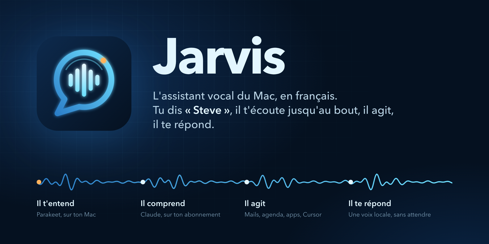

# Jarvis

<a href="README.md">Français</a> · <a href="README.en.md">English</a> · <a href="README.zh.md">中文</a> · <b>ქართული</b>

ხმოვანი ასისტენტი Mac-ისთვის, რომელიც ყოველთვის გისმენს. დაუძახე სახელით (თავიდან **Steve**, ქართულად
„სტივ“; სახელის შეცვლა შეგიძლია), გაგიგებს, ხმით გიპასუხებს და Mac-ზე შენს მაგივრად იმუშავებს: აპები, ფანჯრები,
ბრაუზერი, ფოსტა, კალენდარი, შეტყობინებები, ფონზე რამდენიმე აგენტი ერთდროულად და მართვის პანელი. გაღვიძების სიტყვა,
მეტყველების ამოცნობა და ლოკალური ხმა Apple-ის ჩიპზე მუშაობს; ფიქრობს Claude, **შენივე Claude-ის გამოწერით**
(API გასაღები არ გჭირდება).

ის შენს ენებზე ლაპარაკობს: უთხარი, რომელ ენებზე ელაპარაკები (ქართული, English, 中文, Русский, Español… 25 ენა
საკუთარი ხმით, ან Whisper-ის ყველა 99 ენა), და ყოველ წინადადებაში ამოიცნობს, რომელ ენაზე თქვი, და იმავე ენაზე,
იმ ენის ხმით გიპასუხებს.

> სრული დოკუმენტაცია ფრანგულადაა: [README.md](README.md). კოდი და კომენტარებიც ფრანგულადაა; ასისტენტი კი იმ ენაზე
> გიპასუხებს, რომელზეც ელაპარაკები.

## დაყენება

გჭირდება Mac Apple-ის ჩიპით, Python 3.12 და Claude Pro ან Max გამოწერა.

    git clone https://github.com/LdwS123/jarvis.git ~/Jervis && cd ~/Jervis
    python3.12 -m venv .venv && .venv/bin/pip install -r requirements.txt
    curl -fsSL https://claude.ai/install.sh | bash   # Claude Code, თუ ჯერ არ გაქვს
    claude auth login                                # შენი Claude-ის ანგარიში
    ./reglages.command                               # პარამეტრები: სახელი, ენები, ხმა, მოდელი
    ./installer.command                              # მენიუს ზოლის აპი, სისტემაში შესვლისას ჩაირთვება

მისი მოდელები (ხმა, მეტყველების ამოცნობა) პირველ გაშვებაზე თავად ჩამოიტვირთება `modeles/`-ში. შენი მეხსიერება,
საუბრები, ჟურნალი და ხმის ანაბეჭდი მხოლოდ შენს Mac-ზე რჩება და რეპოზიტორიაში არასდროს ხვდება.

## პარამეტრების გვერდი

გახსენი მენიუს ზოლის ხატულიდან → **Réglages…**, მართვის პანელიდან, ან `./reglages.command`-ით (პირველ გაშვებამდეც
მუშაობს). თავად გვერდი ქართულადაც ჩანს.

- **შენი Claude-ის ანგარიში**: ჩანს, შესულია თუ არა Claude Code და რა გამოწერა გაქვს. „დაკავშირება“ ტერმინალში
  ხსნის `claude auth login`-ს; შედიხარ პირდაპირ Claude-ში, გვერდი შენს პაროლს და ელფოსტას ვერასდროს ხედავს.
- **მისი სახელი** (ისიც გაღვიძების სიტყვაა), **შენი მთავარი ენა**, **ენები, რომლებზეც ელაპარაკები**,
  **ლოკალური ხმა**, **Microsoft-ის ხმა**, **Claude-ის მოდელი** (sonnet, opus, haiku).
- „შენახვა“ წერს `reglages.json`-ს რეპოზიტორიის ძირში (მხოლოდ შენთვის წასაკითხი, git-ში არ ხვდება). მერე
  გადატვირთე:

      pkill -f "Jervis.app/Contents"; pkill -f "python -m jervis"; sleep 2; open -a ~/Jervis/Jervis.app

ყველა პარამეტრი გარემოს ცვლადითაც იცვლება, და ცვლადი ყოველთვის გვერდზე ძლიერია:

| ცვლადი | თავიდან | რას აკეთებს |
|---|---|---|
| `JERVIS_PRENOM` | Steve | მისი სახელი და გაღვიძების სიტყვა |
| `JERVIS_LANGUE` | fr | შენი მთავარი ენა (`ka` = ქართული) |
| `JERVIS_LANGUES` | მთავარი ენა | ენები, რომლებზეც ელაპარაკები: `ka,en`, ან `toutes` (ყველა) |
| `JERVIS_VOIX_KA` | ka-GE-GiorgiNeural | ქართული Microsoft-ის ხმა (ქალის ხმა: `ka-GE-EkaNeural`) |
| `JERVIS_VOIX_NEURONALE` | მთავარ ენაზეა დამოკიდებული | მთავარი ენის Microsoft-ის ხმა; `non` = მხოლოდ Mac-ის ხმები |
| `JERVIS_MODELE` | sonnet | Claude-ის მოდელი, რომლითაც ფიქრობს |

## ენების შესახებ

- შენი ენის ამოცნობა Mac-ზე ხდება (Whisper უსმენს წინადადების დასაწყისს და მხოლოდ *შენს* ენებს შორის ირჩევს).
  ყოველ წინადადებას დაახლოებით 0,2–0,3 წამი ემატება; ერთი ენით არაფერი იცვლება.
- ქართულს Whisper წერს (Parakeet მხოლოდ ევროპულ ენებს იცნობს).
- ლოკალური ხმა (Pocket TTS) ქართულად არ ლაპარაკობს: ქართულ პასუხს Microsoft Edge-ის ქართული ხმა კითხულობს
  (იგზავნება მხოლოდ პასუხის ტექსტი, შენი ხმა არასდროს). Mac-ს ქართული ხმა არ აქვს, ამიტომ `JERVIS_VOIX_NEURONALE=non`
  რეჟიმში ქართული ტექსტი ცუდად წაიკითხება.

## კონფიდენციალურობა

შენი ხმა Mac-ს არასდროს ტოვებს: გაღვიძების სიტყვა, ტრანსკრიფცია, ენის ამოცნობა და ხმის ანაბეჭდი ლოკალურად
ითვლება. რასაც ამბობ (ტექსტად) და რასაც შენთვის კითხულობს, Claude-ს ეგზავნება, რომ გიპასუხოს. სრული სია
ფრანგულ README-შია.
