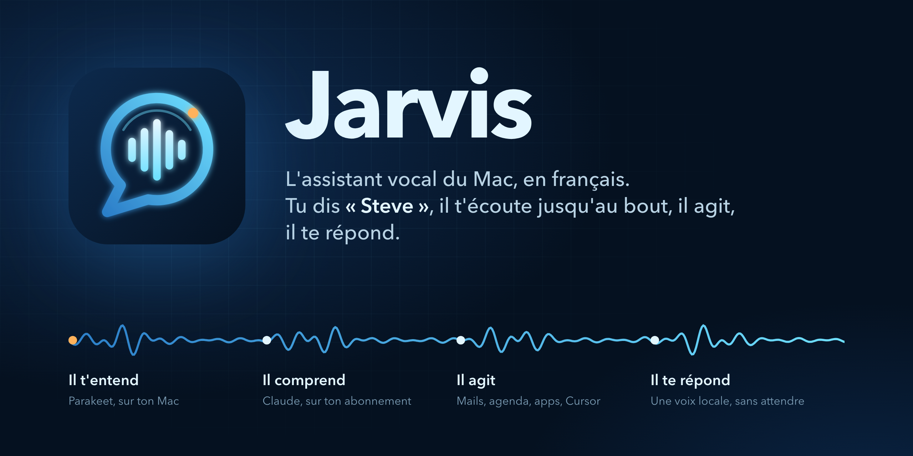

# Jarvis

<a href="README.md">Français</a> · <a href="README.en.md">English</a> · <b>中文</b> · <a href="README.ka.md">ქართული</a>

一个一直在听的 Mac 语音助手。叫它的名字（默认是 **Steve**，中文说「史蒂夫」也可以，名字也可以自己改），
它就能听懂你、用声音回答你，并在 Mac 上帮你做事：打开应用、管理窗口、浏览器、邮件、日历、消息，
还能在后台同时运行多个智能体，并在仪表板上显示进度。唤醒词、语音识别和本地语音都在 Apple 芯片上运行；
思考由 Claude 完成，**用的是你自己的 Claude 订阅**（不需要 API 密钥）。

它会说你的语言：告诉它你说哪些语言（中文、English、ქართული、Español、日本語……共 25 种有专门的声音，
或者 Whisper 支持的全部 99 种），它会逐句识别你用的语言，并用同一种语言、同一种语言的声音回答你。

> 完整文档是法语的：[README.md](README.md)。代码和注释也是法语；助手本身会用你对它说的语言回答。

## 安装

需要一台 Apple 芯片的 Mac、Python 3.12，以及 Claude Pro 或 Max 订阅。

    git clone https://github.com/LdwS123/jarvis.git ~/Jervis && cd ~/Jervis
    python3.12 -m venv .venv && .venv/bin/pip install -r requirements.txt
    ./installer.command                              # 安装页面，然后是菜单栏应用（登录时自动启动）

第一次运行时，`installer.command` 会在浏览器里打开**安装页面**并等待：

1. **连接你的 Claude 账号**：按钮会在终端里打开 `claude auth login`（如果还没有 Claude Code，会先用官方安装程序安装）。
   你直接在 Claude 登录；页面只知道登录完成了（每 3 秒自动检查一次），永远看不到你的密码或邮箱。
2. **选择设置**：名字、语言、声音、模型、速度。都可以不填。
3. **完成并启动**：账号连接后按钮才可以点；页面关闭，安装继续。

连接并保存之后，页面不会再出现（`./installer.command --sans-page` 可以跳过）。如果应用启动时 Claude 账号没有连接，
图标会变成 🔑，它会告诉你，打开设置页面的「连接」，登录后自动启动。

第一次启动时，它的模型（声音、语音识别）会自动下载到 `modeles/`。你的记忆、对话、日志和声纹
只保存在你的 Mac 上，永远不会进入代码仓库。

## 设置页面

从菜单栏图标 → **Réglages…** 打开，或者在仪表板里打开，或者运行 `./reglages.command`（第一次启动之前也可以用）。
页面本身可以切换成中文显示。

- **你的 Claude 账号**：显示 Claude Code 是否已登录，以及订阅类型。点「连接」会在终端里打开
  `claude auth login`，你直接在 Claude 登录，页面永远看不到你的密码或邮箱。
- **它的名字**（也是唤醒词）、**你的主要语言**、**你对它说的语言**、**本地声音**、**微软声音**、
  **Claude 模型**（sonnet、opus、haiku）、**回答速度**（默认 `low` 回答最快；`medium`、`high` 说话前想得更多）。
- 点「保存」会写入仓库根目录的 `reglages.json`（只有你能读，不会被 git 提交）。然后重启它：

      pkill -f "Jervis.app/Contents"; pkill -f "python -m jervis"; sleep 2; open -a ~/Jervis/Jervis.app

想用中文作为主要语言，例如：主要语言选「中文」，语言勾选「中文」和「English」。它会说「Steve 已上线。」，
用 `zh-CN-YunxiNeural` 的声音说中文，用英文声音说英文。

每个设置也可以用环境变量来改，环境变量总是优先于页面：

| 变量 | 默认值 | 作用 |
|---|---|---|
| `JERVIS_PRENOM` | Steve | 它的名字，也是唤醒它的词 |
| `JERVIS_LANGUE` | fr | 你的主要语言（`zh` = 中文） |
| `JERVIS_LANGUES` | 主要语言 | 你对它说的语言：`zh,en`，或 `toutes`（全部） |
| `JERVIS_VOIX_ZH` | zh-CN-YunxiNeural | 中文的微软声音（女声：`zh-CN-XiaoxiaoNeural`） |
| `JERVIS_VOIX_NEURONALE` | 取决于主要语言 | 主要语言的微软声音；`non` = 只用 Mac 自带的声音，什么都不发给微软 |
| `JERVIS_MODELE` | sonnet | 它用来思考的 Claude 模型 |
| `JERVIS_EFFORT` | low | 回答前想多少：`low` 说话最快，`medium`、`high` 想得更多 |
| `JERVIS_COUPURE_S` | 0.5 | 你的声音盖过它多少秒后，它立刻停下来听你说（如果不是对它说的，它会接着说） |

## 关于语言

- 识别你说的是哪种语言在 Mac 上完成（Whisper 听你句子的开头，只在*你的*语言里选）。每句话大约多 0.2–0.3 秒；
  只用一种语言时什么都不变。
- 中文由 Whisper 转写（Parakeet 只支持欧洲语言）。
- 本地声音（Pocket TTS）不会说中文：中文回答用微软 Edge 的中文声音朗读（只发送回答的文字，绝不发送你的声音），
  备用是 Mac 的中文声音（Tingting）。

## 隐私

你的声音永远不会离开 Mac：唤醒词、转写、语言识别和声纹都在本地计算。你说的话（文字）以及它替你读取的内容
会发送给 Claude，以便回答。完整说明见法语 README。
